# Venator roadmap

End goal: command the drone from any laptop over LoRa, with **zero interaction on
the Jetson**, including a "fly to these coordinates" mission.

  <picture>
    <source media="(prefers-color-scheme: dark)" srcset="../assets/brand/avoid-dark.svg">
    
  </picture>

The furthest thing on this list, drawn so it is clear what is being aimed at.
**None of it is built.** `run_mission2` steers toward a person and otherwise
hovers in place, and the only rangefinder discussed anywhere in this repo is a
*downward* lidar for altitude.

What exists are the two ends. `drone/camera_publisher.py` already runs a
`MobileNetSpatialDetectionNetwork` on the OAK-D's stereo depth, so forward
distance is a matter of reading the depth map rather than the detections. PX4
1.13 already accepts `OBSTACLE_DISTANCE` from a companion computer and brakes
against it with `CP_DIST`. The link between those two ends is the work.

Mission 2 as designed — the goal this is all pointed at — is on the
[landing page](https://sarreola07.github.io/VENATOR/).

## Status

  <picture>
    <source media="(prefers-color-scheme: dark)" srcset="../assets/brand/phases-dark.svg">
    
  </picture>

| Phase | What | State |
|---|---|---|
| 0 | NVMe install + restore project (see [REINSTALL.md](REINSTALL.md)) | ✅ done |
| 1 | C2 protocol ([PROTOCOL.md](PROTOCOL.md), `radio/protocol.py`) | ✅ done |
| 2 | Portable laptop client + mock + CI to build `.exe`/`.app` | 🔵 in progress |
| 3 | Bidirectional Heltec firmware (half-duplex transceiver) | ✅ flashed + validated on real radios; OLED status on both sticks. Also strips/adds the RYLR998's 5-byte header so the Pico gateway interoperates |
| 3b | Handheld LoRa remote (`radio/firmware/Venator_Remote`) | ✅ motor tests + props refusal verified on the real aircraft; setup wizard compiles, not yet flashed |
| 3c | Pico + RYLR998 gateway (`radio/firmware/Pico_Gateway`) | 🔵 talks to the drone; framing is last-peer-wins, so do not power it alongside the Heltec remote |
| 4 | Jetson C2 server + systemd boot service (zero-touch) | ✅ **motors spun on the real aircraft from the handheld remote, 2026-10-21** — this needed `MAV_CMD_ACTUATOR_TEST`; `DO_MOTOR_TEST` is ArduPilot-only and PX4 answered it UNSUPPORTED, so nothing had ever actually turned through this path |
| 4b | Boot services for camera + hotspot + C2 (`field_mode.sh`) | 🔵 units, key split and crash-loop guards done; **not yet verified across a reboot with hardware attached** |
| 5 | GPS + waypoint flight | 🔵 upload + flight trigger + two-step arm + link-loss RTL built & bench-tested, but **blocked: PX4 reports `fix_type 0`, 0 sats** with `GPS_1_CONFIG=201` — an M10 cable/port fault. No outdoor flight has happened |
| — | Mission 1: hover + detect people + land | 🔵 built & bench-tested (mock only); hover 2 m on GPS, person detection over LoRa. Needs the GPS fixed first; true 3 ft needs the downward lidar, since `EKF2_HGT_REF=2` currently falls back to the baro |
| — | Mission 2: follow the person until LoRa STOP | 🔵 built & bench-tested (mock only); OFFBOARD velocity follow (keep 3 m), STOP->land, camera-loss->hover, link-loss->RTL |
| 6 | Polish: auto-launch agents, saved "places", browser GUI, OFFBOARD follow | ⬜ |
| 6 | Forward obstacle avoidance — deviate around what the OAK-D sees | ⬜ not started |

> **The site shows the finished system; this table is the status.** The search
> and rescue banner on [how-it-works][site] runs the mission end to end — fence,
> coverage path, a real-time reroute around a tree, a deer logged, a casualty
> found and an emergency sent — with no caveats on it, the same way
> `conops-*.svg` shows Mission 2 as designed rather than as built. That is the
> target. Where the two disagree, **this table is the one that is true**: the
> reroute is Phase 6 and has not started, outdoor flight is still pending, and
> `camera_publisher.py` detects people with depth, not posture.

[site]: https://sarreola07.github.io/VENATOR/how-it-works.html

## Phase details

- **1 — Protocol** *(done):* versioned, newline-JSON messages; handshake, menu,
  run, waypoint upload, ACK/retransmit. Shared by client and Jetson server.
- **2 — Client** *(in progress):* `ground/gcs_client.py` auto-detects the Heltec
  (CP210x VID), handshakes, renders the Jetson's menu, uploads waypoints. Runs
  today with `--mock` (no hardware). The GitHub Actions workflow builds
  `VenatorGCS.exe` and `.app` — download from the run's Artifacts.
- **3 — Firmware:** merge the two working sketches into one half-duplex
  transceiver (transparent line bridge, same 915 MHz/SF7/syncword). Flash both
  sticks.
- **4 — Jetson server** *(server done):* `drone/c2_server.py` owns the LoRa
  serial and the Pixhawk; serves the menu, runs missions (reusing `drone/missions.py`),
  streams ACK/DONE. Defaults to a **mock FC** (`--real` connects the Pixhawk) but props default **ON**; `--real`
  connects the Pixhawk, `--props-on` enables flight. Tested end-to-end against the
  real client over a loopback — props + GPS gates verified.
  `deploy/systemd/venator-c2.service.in` is the template for the zero-touch boot
  unit (enable deliberately). The two-step arm confirm, the link-loss failsafe
  (`LINK_LOSS_S = 4.0` → RTL) and mid-mission `ABORT` are all in place: the
  mission loops poll the link while flying instead of blocking, so aborts and
  heartbeats are handled promptly. Since 2026-10-21 `confirm()` also **re-checks**
  props and GPS at launch time, not just when the flight was prepared — props can
  be toggled inside the 60 s confirm window, and on an unauthenticated link
  anything in radio range can inject that toggle.
  **One exception, still open:** menu id 3 ("Fly to waypoints") carries no `fly`
  key, so it is not routed through `_prepare`/`CONFIRM` — it goes straight to
  `missions.mission_3(..., require_confirm=False)`, which arms after a 3 s sleep.
  It is still gated on props ON plus a GPS fix, so it cannot fire on the bench,
  but it is the only flight path in the system without a second step.
- **5 — Waypoint flight:** ⚠️ **blocked on GPS hardware.** The Holybro M10 is
  fitted and `GPS_1_CONFIG=201` is set, but PX4 reports `fix_type 0` with 0
  satellites and `XY_POSITION_CONTROL` unhealthy — an M10 cable or port fault,
  not configuration. Nothing that needs a position estimate can run until that
  is fixed. The plumbing is built: upload via `MISSION_ITEM_INT` →
  `AUTO.MISSION`, altitude cap + RTL-last, bench-validated acceptance.
- **6 — Polish:** zero-click launch agents on your own Win/Mac, a saved places
  library, a browser GUI, and the OFFBOARD-mode camera-follow port.
- **6 — Obstacle avoidance** *(not started):* nothing in this repo avoids
  anything today — `run_mission2` steers toward a person and otherwise hovers in
  place, and the only rangefinder discussed is a *downward* lidar for altitude.
  The hardware is already most of the way there: `drone/camera_publisher.py`
  runs a `MobileNetSpatialDetectionNetwork` on the OAK-D's stereo depth, so
  forward obstacle distance is a matter of reading the depth map rather than the
  detections. PX4 accepts `OBSTACLE_DISTANCE` / `DISTANCE_SENSOR` from a
  companion computer and will brake against it with `CP_DIST` — established
  against 1.13, the firmware at the time, and not re-checked on the 1.17.0 this
  aircraft now runs. The patrol animation shows this deviation marked as not
  built.

## Open decisions (needed by Phase 4/5)

1. Link-loss during flight: RTL or land-in-place? (default: RTL)
2. Geofence radius + altitude cap.
3. Coordinates: free-typed, saved "places", or both?
4. Client UI: CLI now, browser GUI later.
5. **Message addressing** — see below. Blocks putting a third radio on the link,
   and is the same gap that leaves the command link unauthenticated. See
   [SECURITY.md](SECURITY.md).

## A third radio: what it takes

LoRa is a broadcast medium, so a third stick on 915 MHz / SF7 / syncword 0x12
hears every packet with no firmware change at all. The radio layer is free. What
is not free is that nothing in the protocol says who a message is *from* or *to*.
Two consequences, the second of which matters before the drone flies.

**Delivery confirmation stops being honest.** `radio/phone_relay.py` ACKs every LOG it
hears, unconditionally, before its own dedup check. With two peers instead of
one, both hear a message at the same instant and both transmit an ACK
immediately -- those two ACKs collide on air and cancel each other out. The
`MIN_SEND_GAP_S` pacing in `radio.link_test.Link` is per-node and knows nothing about
what other nodes are doing. The likely result is that both peers display the
message correctly while the sender shows "not confirmed", i.e. the confirmation
gets less trustworthy as the network grows. And an ACK that does survive only
proves *someone* received it: the second ACK for the same id hits
`pending.pop(...) -> None` and is silently discarded.

Fix shape, roughly 30 lines: carry a `from` (node name) on LOG and ACK; have the
sender wait for ACKs from N-1 distinct peers before reporting delivered, showing
partial state ("1 of 2") rather than a bare tick; and give each node a
deterministic ACK delay derived from its name so the replies do not overlap.

**Command authority is not divisible today.** `drone/c2_server.py` keeps a
single server-level `self._pending` -- it is not per-client. RUN sets it and
CONFIRM consumes it, with no record of which station sent either. On a
broadcast channel with three radios and no sender identity, one station's RUN
can be completed by a *different* station's CONFIRM, and neither operator would
see that the two halves came from different people. The two-step arm gate exists
precisely so nobody launches a quadcopter by accident, and with a third radio
present it quietly stops being a two-step gate.

So: chat is the safe place to get addressing right. Add `from` before a third
radio goes anywhere near the flight link, and make the arm gate remember which
station armed it.
